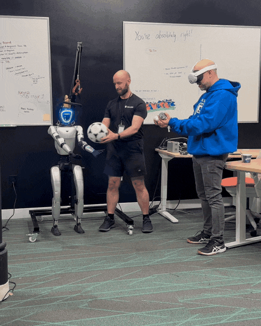
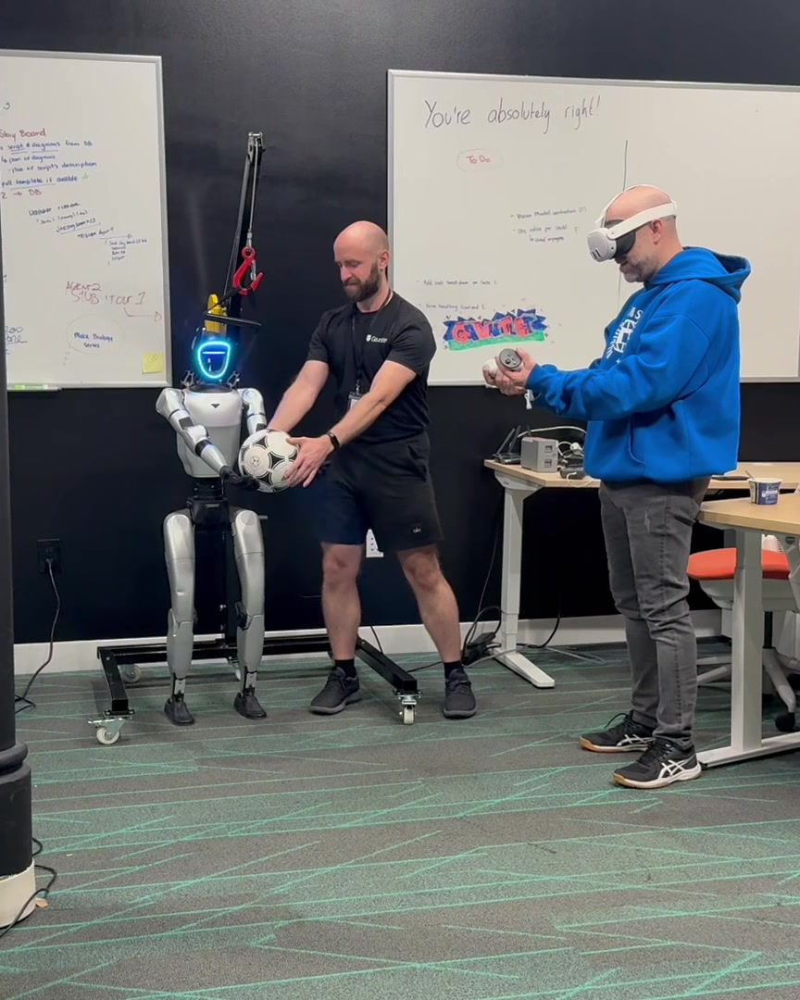
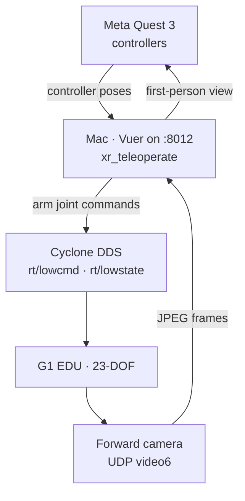

# Unitree G1 EDU teleoperation from a Meta Quest 3

Harrison Glenn. Built during [Gauntlet AI](https://gauntletai.com) hardware week, December 2025.

A Meta Quest 3 drives the arms of a Unitree G1 EDU (23-DOF) in real time. On the Mac, a patched [xr_teleoperate](https://github.com/unitreerobotics/xr_teleoperate) turns controller poses into joint commands and publishes them with Unitree SDK2 over Cyclone DDS. The robot's forward camera comes back into the headset.

First teleop commit: December 5, 2025. Stable arm control and visual passthrough: December 6.

## Demo



Five-second loop from the December 5 session: grab and unsupported hold, robot and operator framed tight. [11-second clip](media/barry-g1-highlight-11s.mp4) of the grab, the unsupported hold, and the mirrored release (864×1080, room audio).



Still from the same session: the ball going into the G1's hands while the operator drives the arms from the Quest controllers.

## What works

Recorded in the December 6 status notes ([`memory-bank/progress.md`](memory-bank/progress.md), [`memory-bank/activeContext.md`](memory-bank/activeContext.md)):

- **Arms.** Quest controllers move both arms — shoulders, elbows, and wrists — through the `G1_23` low-level controller. `r` starts following. `q` sends the arms home and exits.
- **First-person video.** The forward camera is shown in the headset (`--display-mode=immersive`). As of December 7 the control CLI requests that view as UDP `video6`. The same week also brought the picture up over DDS `VideoClient`, and Unitree's teleimager service is the third option in the notes.
- **Locomotion, when you turn it on.** Quest joysticks send `vx`, `vy`, and `vyaw` in Motion Mode. The locomotion notes cap this at 0.3 m/s linear and 0.3 rad/s angular, with a dead zone under 0.01. Arm-only teleop stays in Debug Mode.
- **Hand tracking** is a separate input mode (`--input-mode=hand`). Quest sends hand data when the controllers are set down, and controller poses when they are held. The two modes are mutually exclusive.

[`memory-bank/currentStatus.md`](memory-bank/currentStatus.md) is an earlier page from when the robot was off. The December 6 notes above are the ones that match the working session.

## Stack

| Piece | Role here |
| --- | --- |
| Meta Quest 3, Quest Browser, Vuer | Controller poses and the headset view, WebSocket on port 8012 |
| xr_teleoperate, with macOS patches | Teleop loop, arm retargeting, IK |
| Unitree SDK2 and Cyclone DDS | `rt/lowstate` in, `rt/lowcmd` out |
| MuJoCo 3.3.7 | Physics package in the environment (pip) |
| Mac | Apple Silicon, Python 3.10, conda env `xr_teleop` |

## Architecture



State comes back on `rt/lowstate` over the same DDS session. Joystick locomotion, when `--enable-locomotion` is set, goes out through `LocoClientWrapper` as `vx`, `vy`, and `vyaw` while the arms stay on the low-level command.

## Engineering notes: what broke and how I fixed it

The week of notes is still in [`docs/`](docs/README.md) and [`memory-bank/`](memory-bank/projectbrief.md). This is the path that actually unblocked teleop, in the order the failures showed up.

### DDS init order, then the interface name

Cyclone DDS domain init is a singleton. `MotionSwitcher` also calls `ChannelFactoryInitialize`. When that ran first, the later call inside the arm controller could not set the NIC, and `ChannelFactoryInitialize(0)` with no interface failed auto-detect on macOS. The Unitree example that connected called `ChannelFactoryInitialize(0, "en7")` at top level. `en7` was this Mac's Ethernet interface to the robot switch.

The fix is that call at the top of `teleop_hand_and_arm.py`, before `MotionSwitcher` and the arm controller, and no second init inside the controller. [`docs/FIXED_DDS_INIT_ORDER.md`](docs/FIXED_DDS_INIT_ORDER.md), [`docs/NETWORK_INTERFACE_FIX.md`](docs/NETWORK_INTERFACE_FIX.md).

Until a sample showed up on `rt/lowstate`, the main thread sat in `Waiting to subscribe dds...` and never reached the keyboard handler, so `r` did nothing. On the robot: power on, Debug Mode (L2+R2, then L2+A), high-level motion service off so it does not fight low-level `rt/lowcmd`. [`docs/DDS_BLOCKING_ISSUE.md`](docs/DDS_BLOCKING_ISSUE.md).

### Polling, callbacks, and a half-second of discovery

The example that connected used `ChannelSubscriber.Init(handler, queueLen)`. Teleop called `Init()` with no callback and polled `Read()` from a thread. With `en7` already set, the callback listener was still not firing ([`docs/DDS_SUBSCRIBER_DIFFERENCE.md`](docs/DDS_SUBSCRIBER_DIFFERENCE.md), [`docs/DEBUG_CALLBACK_ISSUE.md`](docs/DEBUG_CALLBACK_ISSUE.md)). A 0.5 s pause after starting the subscriber thread gave discovery time before the first `Read()` ([`docs/DDS_TIMING_FIX.md`](docs/DDS_TIMING_FIX.md)).

What the later notes settled on is hybrid ([`docs/HYBRID_DDS_APPROACH.md`](docs/HYBRID_DDS_APPROACH.md)): `Read()` until the first sample proves the link, then close and re-init the subscriber with a callback. Logging in that wait went from 10 Hz to 1 Hz so Ctrl+C was not stuck behind prints. After that change, the December 6 notes record the subscribe completing in under a second.

### macOS patches to a Linux SDK

- `sys/sysinfo.h`, `sys/timerfd.h`, and the scheduler constants `SCHED_BATCH`, `SCHED_IDLE`, and `SCHED_DEADLINE` are Linux-only. They are guarded or removed on macOS ([`docs/BUILD_STATUS.md`](docs/BUILD_STATUS.md)).
- `pthread_spinlock_t` is replaced with `os_unfair_lock`.
- Python `timerfd` falls back to `time.sleep` ([`memory-bank/techContext.md`](memory-bank/techContext.md)).
- `lib/arm64` is symlinked to `lib/aarch64` so Apple Silicon resolves the library directory the SDK looks up under the Linux name.

[`docs/BUILD_STATUS.md`](docs/BUILD_STATUS.md) still calls out the prebuilt third-party `.so` files shipped in SDK2: they are Linux binaries, so building every C++ example on macOS was left open. Teleop here runs through the Python SDK.

### Vuer had no process, then no event loop

`TeleVuer` started Vuer in a `multiprocessing.Process`. Pickling `self` died with `self._frozen cannot be converted to a Python object for pickling` ([`docs/PICKLING_ERROR_FIX.md`](docs/PICKLING_ERROR_FIX.md)). On macOS the server runs in a `threading.Thread`. Linux keeps the process. [`docs/FIXED_STATUS.md`](docs/FIXED_STATUS.md).

A fresh thread has no asyncio loop, so the next error was `There is no current event loop in thread 'Thread-5 (_vuer_run)'`. `_vuer_run()` now does `asyncio.new_event_loop()` and `asyncio.set_event_loop(loop)` before `self.vuer.run()`. [`docs/FIX_VUER_EVENT_LOOP.md`](docs/FIX_VUER_EVENT_LOOP.md).

### Controller poses that were the wrong length

After about six minutes the arms could freeze on the last good pose. Quest sometimes sent a controller pose that was not 16 floats. The 4×4 assign raised `ValueError: Can only assign sequence of same size`, and updates stopped. The IK joint limits were a separate concern; this freeze was the shape mismatch.

`televuer.py` now checks the length, pads a 12-float 3×4 up to 4×4, drops a bad frame while keeping the last good pose, and logs the first 10 mismatches. [`docs/CONTROLLER_FREEZE_FIX.md`](docs/CONTROLLER_FREEZE_FIX.md).

A black headset view before `r` is the idle wait ([`docs/VR_BLACK_SCREEN_FIX.md`](docs/VR_BLACK_SCREEN_FIX.md)). The page has to be Quest Browser, then Enter VR ([`docs/QUEST_CONTROLLER_TROUBLESHOOTING.md`](docs/QUEST_CONTROLLER_TROUBLESHOOTING.md)). Holding the controllers under `--input-mode=hand` makes Quest send controller data, and the arms sit on a constant pose ([`docs/HAND_TRACKING_VS_CONTROLLER_MODE.md`](docs/HAND_TRACKING_VS_CONTROLLER_MODE.md)).

### Three ways to get a picture into the headset

1. **teleimager** on the robot PC2 (ZMQ/WebRTC, port 60001, config server on 60000). It has to be installed on the robot. A timeout on port 60000 is the config server; the script uses a local camera config and keeps going ([`docs/CAMERA_SETUP_GUIDE.md`](docs/CAMERA_SETUP_GUIDE.md), [`memory-bank/progress.md`](memory-bank/progress.md)).
2. **DDS `VideoClient`** (`--video-source=dds`). No extra install. Same DDS session as control. It needs Debug Mode: in Zero Torque the RPC returns `3102` `RPC_ERR_CLIENT_SEND` ([`docs/DDS_VIDEO_MODE_REQUIREMENT.md`](docs/DDS_VIDEO_MODE_REQUIREMENT.md)). [`docs/DDS_VIDEO_INTEGRATION_COMPLETE.md`](docs/DDS_VIDEO_INTEGRATION_COMPLETE.md) describes JPEG at 1920×1080, resized for VR, and lists about 15 FPS for this path and about 60 FPS for teleimager. Those figures are from that note.
3. **UDP `video6`**, which the CLI passes as `--video-source=udp` (December 7). The robot's UDP video server sends JPEG from the forward USB camera. [`test_udp_video6.py`](test_udp_video6.py) listens on **port 5002** at 1920×1080 and caps the test window at 24 FPS. [`docs/UDP_VIDEO_CLIENT.md`](docs/UDP_VIDEO_CLIENT.md) also writes a `50000 + N` map that puts video6 on 50006. The client in this repo binds 5002, which is also what that note says in its command-line section.

The headset loads `https://<mac>:8012`. When that page opens on the Mac and fails from the Quest, the macOS firewall is blocking the conda Python or TCP 8012 ([`docs/FIREWALL_TROUBLESHOOTING.md`](docs/FIREWALL_TROUBLESHOOTING.md)). DDS itself uses dynamic UDP ports. The UDP video note also says to allow the video ports.

## Planned

Still open. Full writeup: [`docs/PRD_AUDIO_AND_HIP_CONTROL.md`](docs/PRD_AUDIO_AND_HIP_CONTROL.md).

- **Audio both ways.** Quest mic to `AudioClient.PlayStream` to the robot speakers. Robot mic back on multicast UDP `239.255.1.1:50000` into the headset. PCM, 16 kHz, 16-bit. The spec's latency target is under 100 ms. The open question in that doc is whether Vuer exposes the Web Audio API.
- **Hip lean.** Right stick Y pitches the hips only while `vx`, `vy`, and `vyaw` are near zero, clamped to ±0.1 rad (about 5.7°). If the operator asks for locomotion while leaned, the spec returns the hips to neutral, calls `BalanceStand`, then allows locomotion. Joint indices in the PRD: `kLeftHipPitch = 0`, `kRightHipPitch = 6`.

## Quick start

macOS on Apple Silicon, Homebrew, Xcode command-line tools, and the conda env `xr_teleop` (Python 3.10). System packages:

```bash
brew install cmake pkg-config eigen boost yaml-cpp spdlog fmt
```

Build notes are in [`docs/INSTALLATION_GUIDE.md`](docs/INSTALLATION_GUIDE.md), [`install.sh`](install.sh), and [`build.sh`](build.sh). From the repo root:

```bash
export CYCLONEDDS_HOME="$PWD/dependencies/cyclonedds/install"
```

`CYCLONEDDS_HOME` used to be hardcoded under one home directory. Point it at this checkout.

The dependency directories are gitlinks (pinned commits). There is no `.gitmodules` in this repo, so a fresh clone leaves them empty, and `git submodule update --init` has no remote URLs to follow until those are added. What each macOS patch changed is written down in [`docs/RECOVERY_INSTRUCTIONS.md`](docs/RECOVERY_INSTRUCTIONS.md) and [`memory-bank/techContext.md`](memory-bank/techContext.md). Upstream trees are linked at the bottom.

`CONDA_SH` overrides conda discovery. Otherwise the launchers look for `conda.sh` in the Homebrew Miniconda cask path this machine used, then the usual Miniconda / Miniforge / Anaconda locations under `$HOME`.

```bash
bash START_CLI.txt
```

That activates `xr_teleop` and opens `robot_control_cli.py`.

| Key | Action |
| --- | --- |
| 1, then 2 | Dev Mode, then Debug Mode (arms) |
| 3 | Motion Mode (required for locomotion) |
| 8 | Controllers for the arms, joysticks for the legs |
| 9 | Controllers, arms only |
| 0 / a | Hand tracking, with or without locomotion |
| r / q | Start following / arms home and exit |

The same flags, without the menu:

```bash
export CONDA_SH="${CONDA_SH:-/opt/homebrew/Caskroom/miniconda/base/etc/profile.d/conda.sh}"
source "$CONDA_SH"
conda activate xr_teleop
cd dependencies/xr_teleoperate/teleop
python teleop_hand_and_arm.py \
  --arm=G1_23 \
  --input-mode=controller \
  --display-mode=immersive \
  --img-server-ip="${ROBOT_IP:-192.168.123.164}" \
  --video-source=udp
```

`192.168.123.164` is Unitree's usual PC2 address on the robot LAN (`192.168.123.0/24`). The Ethernet interface on this Mac was `en7`. Both are set at the top of [`robot_control_cli.py`](robot_control_cli.py). Add `--enable-locomotion` only in Motion Mode (remote: R1+X). Debug Mode on the remote is L2+R2, then L2+A.

In the headset, open Quest Browser to `https://<mac-ip>:8012` and enter VR. The view stays black until `r`. An "Enter debug mode: Failed" line can mean the robot is already in Debug Mode ([`memory-bank/progress.md`](memory-bank/progress.md)).

`START_XR_TELEOP.sh` is the earlier hand-tracking launcher. It uses `venv_xr_teleop_py310` in the repo root when that virtualenv exists, and otherwise the same conda env. `START_XR_TELEOP_FIXED.sh` is the conda-only copy. Both still launch `teleop_hand_and_arm.py` with `--arm=G1_23 --input-mode=hand --display-mode=immersive`.

## Layout

```
├── media/                          # December 5 loop, highlight clip, handoff still
├── docs/                           # Session notes from the week (kept)
├── memory-bank/                    # Status, architecture, stack
├── dependencies/                   # Gitlinks: Cyclone DDS, SDK2, xr_teleoperate
├── robot_control_cli.py            # Mode switch, teleop launch, r / q over IPC
├── switch_robot_mode.py
├── test_dds_video.py
├── test_udp_video6.py
├── START_CLI.txt
├── START_XR_TELEOP.sh
└── START_XR_TELEOP_FIXED.sh
```

## Docs

Everything written that week is still in [`docs/`](docs/README.md), indexed there. The files cited above are the ones that match the fixes in this README. The `.txt` files in `docs/` are copy-paste commands from the session; many of them still contain the original absolute paths and that lab's addresses.

## Upstream

- [Unitree SDK2](https://github.com/unitreerobotics/unitree_sdk2)
- [unitree_sdk2_python](https://github.com/unitreerobotics/unitree_sdk2_python)
- [xr_teleoperate](https://github.com/unitreerobotics/xr_teleoperate)
- [Cyclone DDS](https://cyclonedds.io/)
- [MuJoCo](https://mujoco.readthedocs.io/)
- [Unitree G1](https://www.unitree.com/products/g1)

## License

Each dependency keeps its own license: MuJoCo is Apache 2.0, Cyclone DDS is Eclipse Public License 2.0, and Unitree SDK2 and xr_teleoperate are whatever those repositories declare.
